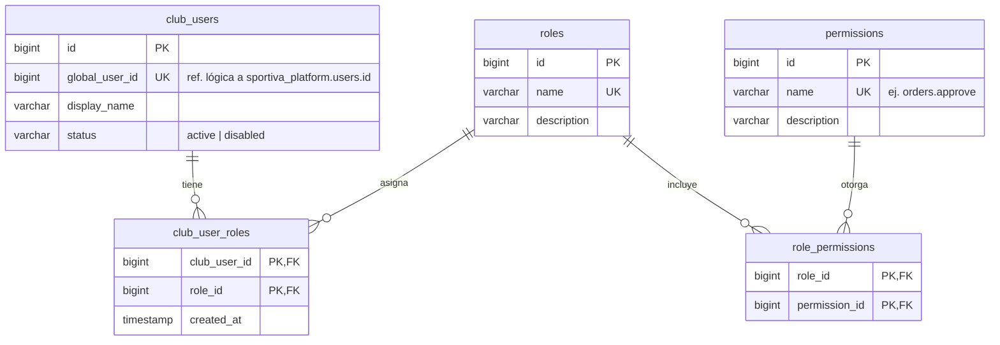

# 1. Identidad local y autorización

[← Índice](README.md)

Representa a los usuarios de la plataforma **dentro de este club** y qué pueden hacer. La autenticación (email y contraseña) y el permiso de entrar al club (`tenant_memberships`) viven en la base central; acá vive el perfil local y los roles del club.

## `club_users`

Perfil local de un usuario global en este club. Se crea cuando el usuario recibe una membresía en el club.

| Columna | Tipo | Null | Restricciones | Descripción |
|---|---|---|---|---|
| `id` | BIGINT UNSIGNED | no | PK | Perfil local |
| `global_user_id` | BIGINT UNSIGNED | no | UK | `sportiva_platform.users.id`. Referencia lógica, **no** FK entre bases |
| `display_name` | VARCHAR(120) | no | | Nombre visible dentro del club |
| `status` | VARCHAR(20) | no | | `active` / `disabled` |
| `created_at`, `updated_at` | TIMESTAMP | sí | | |

- `status = disabled` bloquea las operaciones en el club aunque la membresía central siga activa. El middleware valida las dos cosas.
- No lleva `deleted_at`: un usuario que se va del club queda `disabled`, porque pedidos, movimientos y auditoría lo referencian.

## `roles`

| Columna | Tipo | Null | Restricciones | Descripción |
|---|---|---|---|---|
| `id` | BIGINT UNSIGNED | no | PK | |
| `name` | VARCHAR(80) | no | UK | `admin`, `coordinator`, `coach`, `physical_trainer`, `inventory_manager`, `maintenance_manager` |
| `description` | VARCHAR(255) | sí | | |
| `created_at`, `updated_at` | TIMESTAMP | sí | | |

## `permissions`

| Columna | Tipo | Null | Restricciones | Descripción |
|---|---|---|---|---|
| `id` | BIGINT UNSIGNED | no | PK | |
| `name` | VARCHAR(120) | no | UK | Clave estable: `players.view`, `orders.approve`, `inventory.adjust`. El borrador la llama `key` (ver [diferencia 5](README.md#diferencias-con-el-borrador-y-con-el-repo)) |
| `description` | VARCHAR(255) | sí | | |

- Las claves de permiso son las que usan las policies y `Gate::authorize`, y las que devuelve `permissions[]` en `select-tenant` y `/api/me`.

## `club_user_roles`

| Columna | Tipo | Null | Restricciones | Descripción |
|---|---|---|---|---|
| `club_user_id` | BIGINT UNSIGNED | no | PK, FK → `club_users.id` | |
| `role_id` | BIGINT UNSIGNED | no | PK, FK → `roles.id` | |
| `created_at` | TIMESTAMP | sí | | Fecha de asignación |

## `role_permissions`

| Columna | Tipo | Null | Restricciones | Descripción |
|---|---|---|---|---|
| `role_id` | BIGINT UNSIGNED | no | PK, FK → `roles.id` | |
| `permission_id` | BIGINT UNSIGNED | no | PK, FK → `permissions.id` | |

## Reglas

- Las dos tablas pivote usan `ON DELETE CASCADE` hacia `roles` y `permissions`: borrar un rol borra sus asignaciones, no datos de negocio.
- Los roles y permisos iniciales los carga el alta del club (seeder de tenant). Un permiso nuevo en una versión posterior entra por una migración o un seeder idempotente que corre en todas las bases.
- Nunca se autoriza con un rol o permiso enviado por el cliente: siempre se leen de esta base, para el `club_user` del token.
