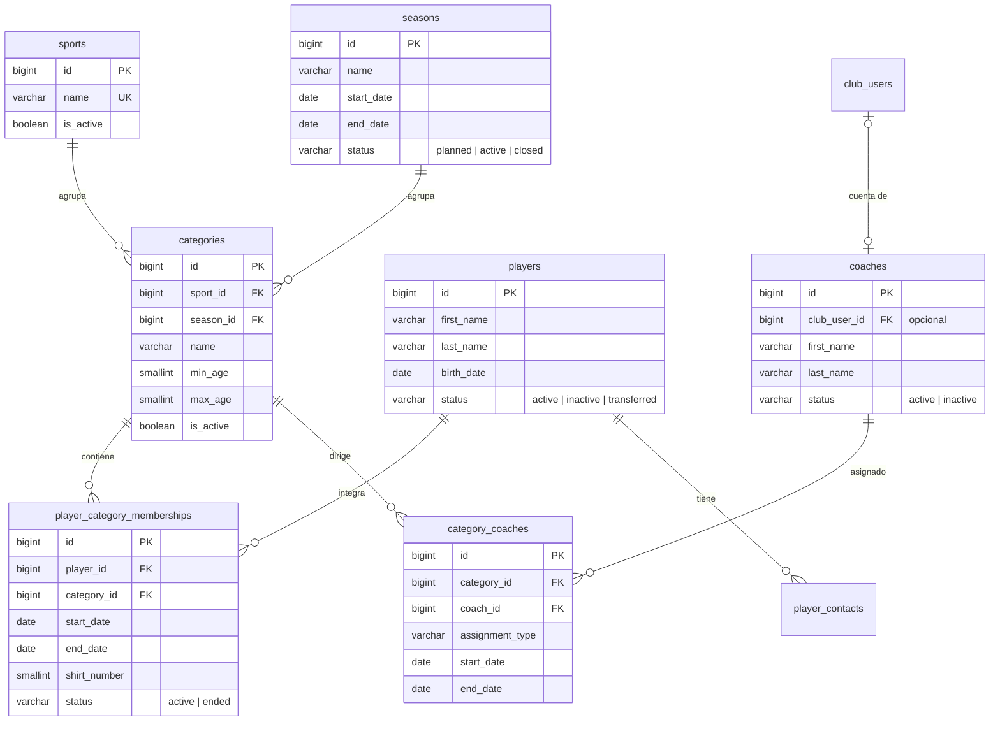

# 2. Deportes, temporadas y planteles

[← Índice](README.md)

La unidad competitiva es la **categoría** (U21, Primera, Pre-mini) de un deporte en una temporada. Los jugadores y entrenadores se asignan a categorías, y esas asignaciones guardan historia.

## `sports`

| Columna | Tipo | Null | Restricciones | Descripción |
|---|---|---|---|---|
| `id` | BIGINT UNSIGNED | no | PK | |
| `name` | VARCHAR(80) | no | UK | Básquet, fútbol, vóley… |
| `is_active` | BOOLEAN | no | default `true` | Si el club ofrece el deporte |
| `created_at`, `updated_at` | TIMESTAMP | sí | | |

## `seasons`

| Columna | Tipo | Null | Restricciones | Descripción |
|---|---|---|---|---|
| `id` | BIGINT UNSIGNED | no | PK | |
| `name` | VARCHAR(80) | no | | "Temporada 2027" |
| `start_date` | DATE | no | | |
| `end_date` | DATE | no | `CHECK (end_date >= start_date)` | |
| `status` | VARCHAR(20) | no | | `planned` / `active` / `closed` |
| `created_at`, `updated_at` | TIMESTAMP | sí | | |

## `categories`

| Columna | Tipo | Null | Restricciones | Descripción |
|---|---|---|---|---|
| `id` | BIGINT UNSIGNED | no | PK | |
| `sport_id` | BIGINT UNSIGNED | no | FK → `sports.id` | |
| `season_id` | BIGINT UNSIGNED | no | FK → `seasons.id` | |
| `name` | VARCHAR(80) | no | | U21, Primera, Pre-mini |
| `min_age` | SMALLINT | sí | | Edad mínima orientativa |
| `max_age` | SMALLINT | sí | | Edad máxima orientativa |
| `is_active` | BOOLEAN | no | default `true` | |
| `created_at`, `updated_at` | TIMESTAMP | sí | | |

- `UNIQUE (sport_id, season_id, name)`: no se repite una categoría en el mismo deporte y temporada.
- Cada temporada nueva crea categorías nuevas, así que el historial de partidos y planteles de la temporada anterior queda intacto.

## `players`

Contiene **datos personales**, muchas veces de menores.

| Columna | Tipo | Null | Restricciones | Descripción |
|---|---|---|---|---|
| `id` | BIGINT UNSIGNED | no | PK | |
| `first_name` | VARCHAR(100) | no | | |
| `last_name` | VARCHAR(100) | no | | |
| `birth_date` | DATE | sí | | Obligatoria en el alta por API (define los requisitos "solo menores", TIZ-32). La columna sigue nullable por los datos previos |
| `document_number` | VARCHAR(30) | sí | | Solo si el club lo necesita (pendiente de definir) |
| `registration_number` | VARCHAR(50) | sí | | Ficha o pase federativo |
| `preferred_position` | VARCHAR(50) | sí | | |
| `dominant_side` | VARCHAR(20) | sí | | Lateralidad, si aplica |
| `status` | VARCHAR(20) | no | | `active` / `inactive` / `transferred` |
| `notes` | TEXT | sí | | Observaciones **no sensibles** (nada médico) |
| `created_at`, `updated_at` | TIMESTAMP | sí | | |
| `deleted_at` | TIMESTAMP | sí | | *(convención ABM)* |

- Índice sugerido: `(last_name, first_name)` para la búsqueda en el listado.
- Si se agrega un `UNIQUE` sobre `document_number`, tiene que ignorar los borrados lógicos (ver guía ABM §10).

## `player_category_memberships`

Historial del jugador por categoría y temporada.

| Columna | Tipo | Null | Restricciones | Descripción |
|---|---|---|---|---|
| `id` | BIGINT UNSIGNED | no | PK | |
| `player_id` | BIGINT UNSIGNED | no | FK → `players.id` | |
| `category_id` | BIGINT UNSIGNED | no | FK → `categories.id` | |
| `start_date` | DATE | no | | Desde |
| `end_date` | DATE | sí | | Hasta; `NULL` si sigue |
| `shirt_number` | SMALLINT | sí | | Número en esa categoría |
| `status` | VARCHAR(20) | no | | `active` / `ended` |
| `created_at`, `updated_at` | TIMESTAMP | sí | | |

- Índice: `(player_id, category_id, status)`, para consultar las asignaciones activas.
- Un jugador tiene **una sola asignación activa por deporte** (TIZ-15). Se valida en la aplicación: `POST /categories/{id}/memberships` responde 422, salvo que se mande `close_previous`, que cierra la anterior con la fecha de inicio de la nueva (pase de categoría). Puede jugar a la vez categorías de deportes distintos.
- El número de camiseta único dentro de una categoría también se valida en la aplicación, solo entre las asignaciones activas.
- Dar de baja a un jugador (soft delete) cierra sus asignaciones activas.

## `player_contacts`

Tutores y contactos del jugador (TIZ-15). Reciben los avisos de la convocatoria (TIZ-33).

| Columna | Tipo | Null | Restricciones | Descripción |
|---|---|---|---|---|
| `id` | BIGINT UNSIGNED | no | PK | |
| `player_id` | BIGINT UNSIGNED | no | FK → `players.id`, `ON DELETE CASCADE` | |
| `name` | VARCHAR(150) | no | | |
| `relationship` | VARCHAR(20) | no | | `mother` / `father` / `guardian` / `self` / `other` |
| `phone` | VARCHAR(40) | sí | | Teléfono o mail: al menos uno |
| `email` | VARCHAR(255) | sí | | |
| `is_primary` | BOOLEAN | no | default `false` | Uno solo por jugador; el primero que se carga lo es |
| `created_at`, `updated_at` | TIMESTAMP | sí | | |

- Índice: `(player_id, is_primary)`.

## `coaches`

| Columna | Tipo | Null | Restricciones | Descripción |
|---|---|---|---|---|
| `id` | BIGINT UNSIGNED | no | PK | |
| `club_user_id` | BIGINT UNSIGNED | sí | UK, FK → `club_users.id` | Cuenta del sistema, si el entrenador entra a la plataforma |
| `first_name` | VARCHAR(100) | no | | |
| `last_name` | VARCHAR(100) | no | | |
| `phone` | VARCHAR(40) | sí | | |
| `email` | VARCHAR(255) | sí | | Email de contacto (no es el de login) |
| `status` | VARCHAR(20) | no | | `active` / `inactive` |
| `created_at`, `updated_at` | TIMESTAMP | sí | | |
| `deleted_at` | TIMESTAMP | sí | | *(convención ABM)* |

- El `UNIQUE` en `club_user_id` no está en el borrador: evita que una cuenta quede atada a dos fichas de entrenador. MySQL permite varios `NULL`.

## `category_coaches`

| Columna | Tipo | Null | Restricciones | Descripción |
|---|---|---|---|---|
| `id` | BIGINT UNSIGNED | no | PK | El borrador usa PK `(category_id, coach_id)` (ver [diferencia 8](README.md#diferencias-con-el-borrador-y-con-el-repo)) |
| `category_id` | BIGINT UNSIGNED | no | FK → `categories.id` | |
| `coach_id` | BIGINT UNSIGNED | no | FK → `coaches.id` | |
| `assignment_type` | VARCHAR(40) | no | | `head_coach` / `assistant` / `physical_trainer` |
| `start_date` | DATE | sí | | |
| `end_date` | DATE | sí | | |

- Índice: `(category_id, coach_id, assignment_type)`.
