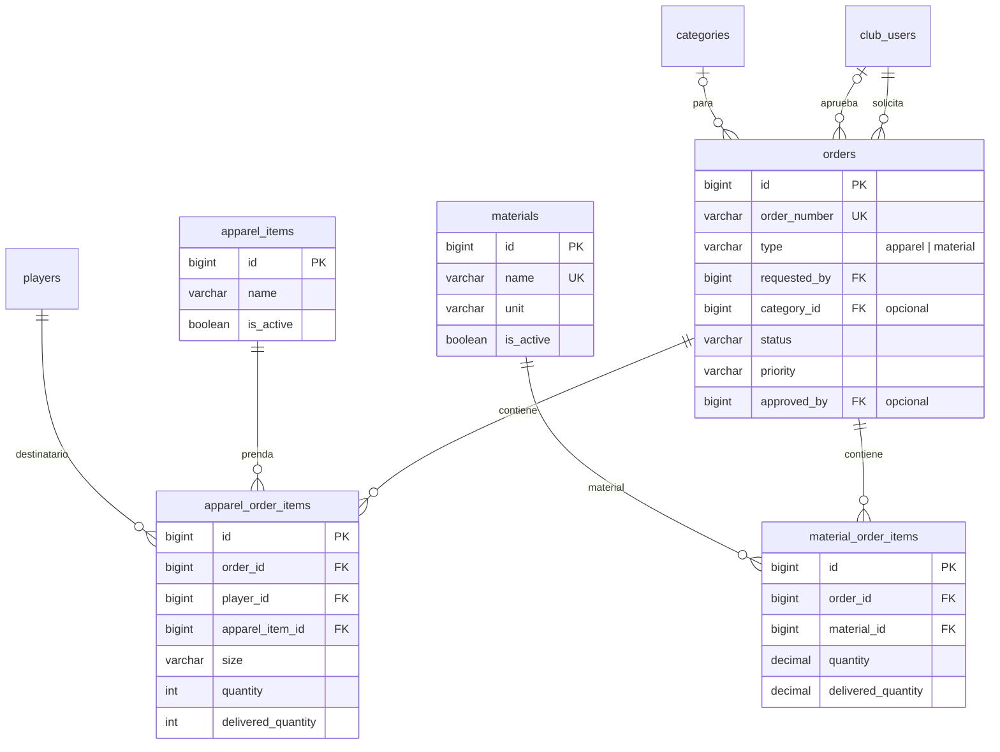

# 3. Pedidos e indumentaria

[← Índice](README.md)

Un pedido (`orders`) es de indumentaria o de materiales. Las líneas van en tablas distintas porque tienen datos distintos: la indumentaria es por jugador, con talle y número; los materiales son por cantidad.

## `orders`

| Columna | Tipo | Null | Restricciones | Descripción |
|---|---|---|---|---|
| `id` | BIGINT UNSIGNED | no | PK | |
| `order_number` | VARCHAR(40) | no | UK | Número visible del pedido |
| `type` | VARCHAR(20) | no | | `apparel` / `material` |
| `requested_by` | BIGINT UNSIGNED | no | FK → `club_users.id` | Solicitante |
| `category_id` | BIGINT UNSIGNED | sí | FK → `categories.id` | Categoría que pide, si aplica |
| `status` | VARCHAR(30) | no | | `draft` / `pending` / `approved` / `preparing` / `partially_delivered` / `delivered` / `rejected` |
| `priority` | VARCHAR(20) | no | default `normal` | `low` / `normal` / `high` / `urgent` |
| `description` | TEXT | sí | | Motivo |
| `approved_by` | BIGINT UNSIGNED | sí | FK → `club_users.id` | |
| `approved_at` | TIMESTAMP | sí | | |
| `delivered_at` | TIMESTAMP | sí | | Entrega completa |
| `created_at`, `updated_at` | TIMESTAMP | sí | | |
| `deleted_at` | TIMESTAMP | sí | | *(convención ABM)* |

- Índices: `(status, created_at)` para la bandeja de pedidos y `(requested_by)`.
- Cada cambio de `status` inserta una fila en [`order_status_history`](08-auditoria-y-notificaciones.md#order_status_history), en la misma transacción.
- Las líneas tienen que coincidir con `type`: un pedido `apparel` solo tiene `apparel_order_items`. Se valida en la aplicación.
- Cómo se genera `order_number` (secuencia por club, prefijo por año…) queda para el change del módulo.

## `apparel_items`

Catálogo de prendas.

| Columna | Tipo | Null | Restricciones | Descripción |
|---|---|---|---|---|
| `id` | BIGINT UNSIGNED | no | PK | |
| `name` | VARCHAR(100) | no | | Camiseta, short, conjunto, campera |
| `description` | VARCHAR(255) | sí | | |
| `is_active` | BOOLEAN | no | default `true` | |
| `created_at`, `updated_at` | TIMESTAMP | sí | | |
| `deleted_at` | TIMESTAMP | sí | | *(convención ABM)* |

## `apparel_order_items`

| Columna | Tipo | Null | Restricciones | Descripción |
|---|---|---|---|---|
| `id` | BIGINT UNSIGNED | no | PK | |
| `order_id` | BIGINT UNSIGNED | no | FK → `orders.id` | |
| `player_id` | BIGINT UNSIGNED | no | FK → `players.id` | Destinatario |
| `apparel_item_id` | BIGINT UNSIGNED | no | FK → `apparel_items.id` | |
| `size` | VARCHAR(20) | no | | Talle |
| `shirt_number` | SMALLINT | sí | | Número impreso |
| `alias` | VARCHAR(50) | sí | | Nombre o apodo impreso |
| `quantity` | INT UNSIGNED | no | `CHECK (quantity > 0)` | Pedida |
| `delivered_quantity` | INT UNSIGNED | no | default 0, `CHECK (delivered_quantity <= quantity)` | Entregada |
| `notes` | VARCHAR(255) | sí | | |

## `materials`

Catálogo de materiales. También lo usa el [inventario](04-inventario.md).

| Columna | Tipo | Null | Restricciones | Descripción |
|---|---|---|---|---|
| `id` | BIGINT UNSIGNED | no | PK | |
| `name` | VARCHAR(120) | no | UK | Pelotas, conos, pesas, colchonetas |
| `description` | VARCHAR(255) | sí | | |
| `unit` | VARCHAR(30) | no | | `unit` / `pair` / `box` / `set` (el borrador los tiene en español; los enums van en inglés) |
| `is_active` | BOOLEAN | no | default `true` | |
| `created_at`, `updated_at` | TIMESTAMP | sí | | |
| `deleted_at` | TIMESTAMP | sí | | *(convención ABM)*; el `UNIQUE` de `name` tiene que ignorar los borrados |

## `material_order_items`

| Columna | Tipo | Null | Restricciones | Descripción |
|---|---|---|---|---|
| `id` | BIGINT UNSIGNED | no | PK | |
| `order_id` | BIGINT UNSIGNED | no | FK → `orders.id` | |
| `material_id` | BIGINT UNSIGNED | no | FK → `materials.id` | |
| `quantity` | DECIMAL(10,2) | no | `CHECK (quantity > 0)` | Pedida |
| `delivered_quantity` | DECIMAL(10,2) | no | default 0, `CHECK (delivered_quantity <= quantity)` | Entregada |
| `notes` | VARCHAR(255) | sí | | |

## Reglas

- Las líneas usan `ON DELETE CASCADE` hacia `orders` solo para borrar borradores (`draft`). Un pedido que salió de `draft` no se borra físicamente: se rechaza o se da de baja con *soft delete*.
- Recibir materiales de un pedido: se crea un `inventory_movement` con `order_id` y se suma `delivered_quantity` en la línea, en la misma transacción. El `status` del pedido pasa a `partially_delivered` o `delivered` según las líneas.
