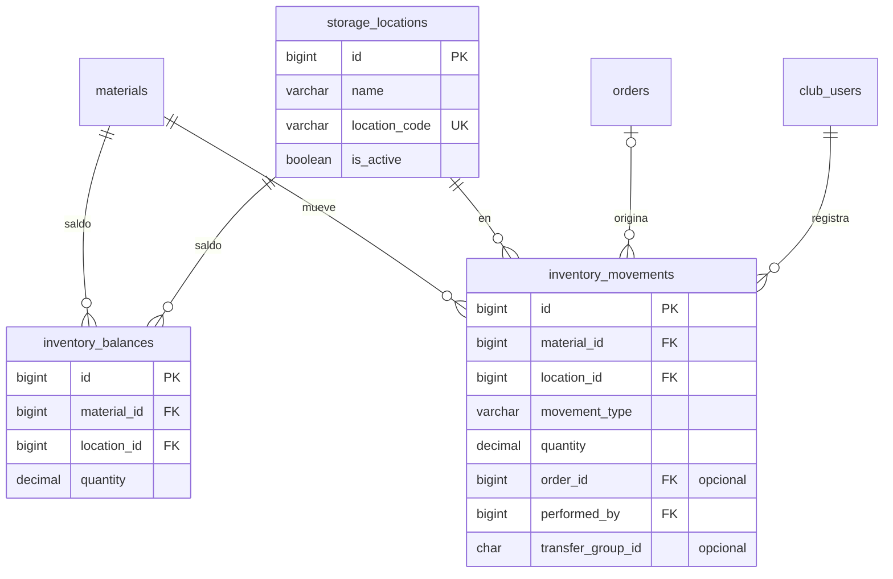

# 4. Depósitos e inventario

[← Índice](README.md)

Stock de [`materials`](03-pedidos-e-indumentaria.md#materials) por ubicación. Funciona como un libro contable: los movimientos son la historia y nunca se editan; el saldo es el resultado, y se mantiene en la misma transacción.

## `storage_locations`

| Columna | Tipo | Null | Restricciones | Descripción |
|---|---|---|---|---|
| `id` | BIGINT UNSIGNED | no | PK | |
| `name` | VARCHAR(120) | no | | Depósito o ubicación |
| `location_code` | VARCHAR(40) | sí | UK | Código interno |
| `description` | VARCHAR(255) | sí | | |
| `is_active` | BOOLEAN | no | default `true` | |
| `created_at`, `updated_at` | TIMESTAMP | sí | | |
| `deleted_at` | TIMESTAMP | sí | | *(convención ABM)* |

## `inventory_balances`

Saldo actual por material y ubicación.

| Columna | Tipo | Null | Restricciones | Descripción |
|---|---|---|---|---|
| `id` | BIGINT UNSIGNED | no | PK | |
| `material_id` | BIGINT UNSIGNED | no | FK → `materials.id` | |
| `location_id` | BIGINT UNSIGNED | no | FK → `storage_locations.id` | |
| `quantity` | DECIMAL(12,2) | no | default 0, `CHECK (quantity >= 0)` | Existencia actual |
| `updated_at` | TIMESTAMP | sí | | |

- `UNIQUE (material_id, location_id)`: un saldo por material y ubicación.
- El `CHECK (quantity >= 0)` no está en el borrador: impide stock negativo a nivel de base. Si el club necesitara stock negativo transitorio, se saca en el change del módulo.

## `inventory_movements`

Libro de movimientos. **Inmutable**: un error se corrige con un movimiento `adjustment`, nunca editando o borrando una fila.

| Columna | Tipo | Null | Restricciones | Descripción |
|---|---|---|---|---|
| `id` | BIGINT UNSIGNED | no | PK | |
| `material_id` | BIGINT UNSIGNED | no | FK → `materials.id` | |
| `location_id` | BIGINT UNSIGNED | no | FK → `storage_locations.id` | Ubicación afectada |
| `movement_type` | VARCHAR(20) | no | | `in` / `out` / `adjustment` / `transfer_in` / `transfer_out` |
| `quantity` | DECIMAL(12,2) | no | | Ver la regla de signo abajo |
| `transfer_group_id` | CHAR(36) | sí | índice | UUID compartido por los dos lados de una transferencia. El borrador lo menciona como opcional; se propone incluirlo |
| `order_id` | BIGINT UNSIGNED | sí | FK → `orders.id` | Pedido asociado |
| `performed_by` | BIGINT UNSIGNED | no | FK → `club_users.id` | |
| `reason` | VARCHAR(255) | sí | | |
| `reference` | VARCHAR(100) | sí | | Remito, factura u otro número externo |
| `created_at` | TIMESTAMP | no | | Sin `updated_at`: la fila no cambia |

- Índice: `(material_id, location_id, created_at)` para el historial de un material.
- **Signo (D14):** en `in`, `out`, `transfer_in` y `transfer_out` la cantidad es positiva y el tipo decide si suma o resta. En `adjustment`, se implementa con cantidad con signo (positivo suma, negativo resta; distinto de cero), documentada como decisión a confirmar con el equipo (TIZ-17).

## Reglas

- Todo cambio de stock hace, **en una sola transacción**: insertar el movimiento y actualizar el saldo con `SELECT … FOR UPDATE` sobre la fila de `inventory_balances` (o `upsert` si no existe). Así dos operaciones simultáneas no pierden una actualización.
- Transferencia entre depósitos: dos movimientos (`transfer_out` en el origen, `transfer_in` en el destino) con el mismo `transfer_group_id`, en la misma transacción.
- Ninguna FK de esta tabla usa `CASCADE`.
- Si el saldo y la suma de movimientos alguna vez difieren, manda el libro de movimientos: un comando de reconciliación puede recalcular los saldos.
