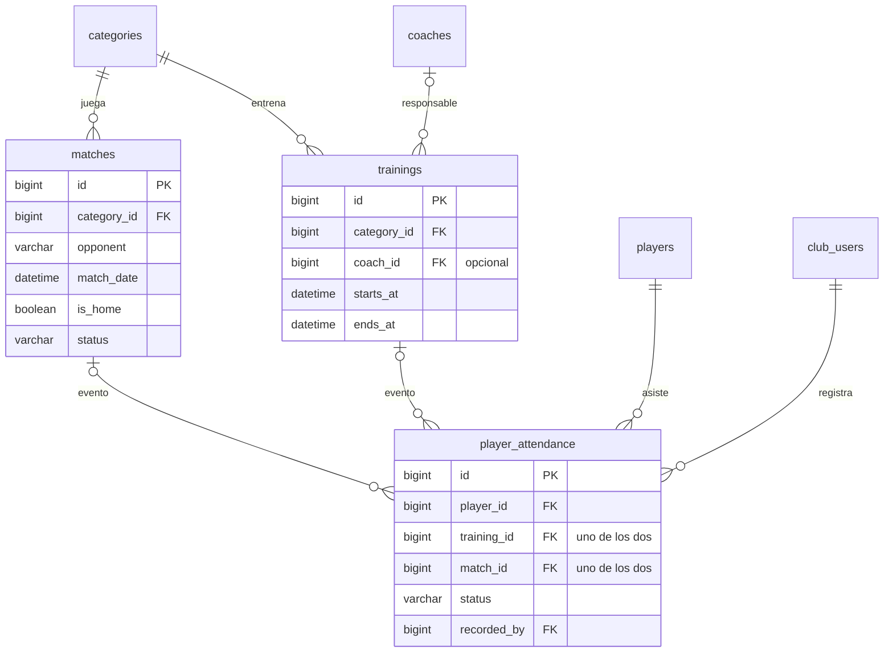

# 5. Partidos, entrenamientos y asistencia

[← Índice](README.md)

Partidos y entrenamientos son de una categoría. La asistencia se toma por jugador y por evento, que es un partido **o** un entrenamiento.

## `matches`

| Columna | Tipo | Null | Restricciones | Descripción |
|---|---|---|---|---|
| `id` | BIGINT UNSIGNED | no | PK | |
| `category_id` | BIGINT UNSIGNED | no | FK → `categories.id` | Categoría que juega |
| `opponent` | VARCHAR(120) | no | | Rival |
| `match_date` | DATETIME | no | | Fecha y hora (UTC) |
| `venue` | VARCHAR(200) | sí | | Lugar |
| `is_home` | BOOLEAN | no | | Local o visitante |
| `uniform_color` | VARCHAR(50) | sí | | |
| `our_score` | SMALLINT UNSIGNED | sí | | |
| `opponent_score` | SMALLINT UNSIGNED | sí | | |
| `status` | VARCHAR(20) | no | | `scheduled` / `played` / `postponed` / `cancelled` |
| `notes` | TEXT | sí | | |
| `created_at`, `updated_at` | TIMESTAMP | sí | | |
| `deleted_at` | TIMESTAMP | sí | | *(convención ABM)* |

- Índice: `(category_id, match_date)` para el fixture de una categoría.
- El resultado se carga solo con `status = played`. Se valida en la aplicación.

## `trainings`

| Columna | Tipo | Null | Restricciones | Descripción |
|---|---|---|---|---|
| `id` | BIGINT UNSIGNED | no | PK | |
| `category_id` | BIGINT UNSIGNED | no | FK → `categories.id` | |
| `coach_id` | BIGINT UNSIGNED | sí | FK → `coaches.id` | Responsable |
| `starts_at` | DATETIME | no | | |
| `ends_at` | DATETIME | no | `CHECK (ends_at > starts_at)` | |
| `location` | VARCHAR(150) | sí | | Cancha o ubicación, texto libre |
| `objectives` | TEXT | sí | | |
| `notes` | TEXT | sí | | |
| `created_at`, `updated_at` | TIMESTAMP | sí | | |
| `deleted_at` | TIMESTAMP | sí | | *(convención ABM)* |

- Índice: `(category_id, starts_at)`.
- `location` es texto. Si más adelante se reservan instalaciones, se puede agregar `facility_id` (FK → [`facilities`](07-instalaciones-y-mantenimiento.md#facilities)) sin romper nada.

## `player_attendance`

| Columna | Tipo | Null | Restricciones | Descripción |
|---|---|---|---|---|
| `id` | BIGINT UNSIGNED | no | PK | |
| `player_id` | BIGINT UNSIGNED | no | FK → `players.id` | |
| `training_id` | BIGINT UNSIGNED | sí | FK → `trainings.id` | |
| `match_id` | BIGINT UNSIGNED | sí | FK → `matches.id` | |
| `status` | VARCHAR(20) | no | | `present` / `absent` / `excused` / `late` |
| `notes` | VARCHAR(255) | sí | | |
| `recorded_by` | BIGINT UNSIGNED | no | FK → `club_users.id` | Quién tomó asistencia |
| `created_at` | TIMESTAMP | no | | |

- `CHECK ((training_id IS NULL) <> (match_id IS NULL))`: exactamente uno de los dos tiene valor. MySQL 8.4 aplica los `CHECK`.
- `UNIQUE (player_id, training_id)` y `UNIQUE (player_id, match_id)`: un registro por jugador y evento. Tienen que ser **dos** índices: uno solo sobre las tres columnas no evitaría duplicados, porque MySQL no compara `NULL` en un índice único ([diferencia 7](README.md#diferencias-con-el-borrador-y-con-el-repo)).
- Corregir una asistencia actualiza la fila (el `UNIQUE` lo obliga). El borrador no tiene `updated_at`; se propone agregarlo para saber cuándo se corrigió.
- Que el jugador pertenezca a la categoría del evento se valida en la aplicación con `player_category_memberships`.
