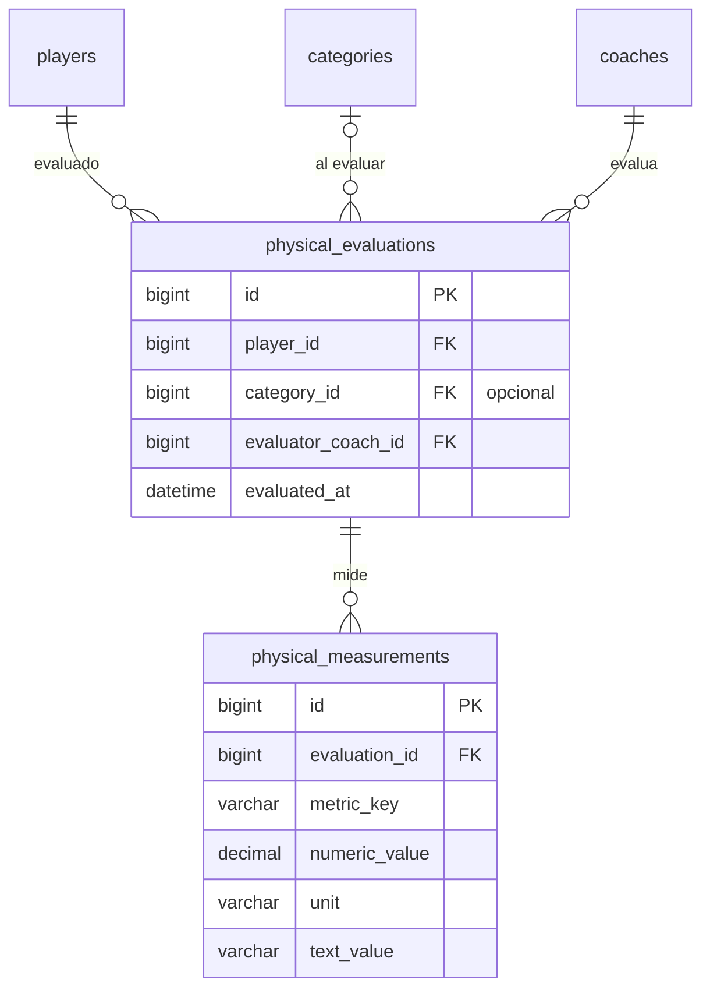

# 6. Evaluaciones físicas

[← Índice](README.md)

Una evaluación es el evento (quién evaluó a quién y cuándo); cada prueba es una medición. Así se pueden agregar pruebas nuevas (flexibilidad, salto, velocidad) sin agregar columnas.

> **Datos sensibles.** Son datos de salud y rendimiento de personas, muchas veces menores. Antes de implementar el módulo hay que definir qué se mide, quién lo ve (solo preparadores físicos, entrenadores y roles autorizados) y cuánto tiempo se guarda. Las lecturas y modificaciones relevantes se registran en [`audit_logs`](08-auditoria-y-notificaciones.md#audit_logs).

## `physical_evaluations`

| Columna | Tipo | Null | Restricciones | Descripción |
|---|---|---|---|---|
| `id` | BIGINT UNSIGNED | no | PK | |
| `player_id` | BIGINT UNSIGNED | no | FK → `players.id` | Evaluado |
| `category_id` | BIGINT UNSIGNED | sí | FK → `categories.id` | Categoría en la que estaba al evaluarlo |
| `evaluator_coach_id` | BIGINT UNSIGNED | no | FK → `coaches.id` | Profesor o preparador físico |
| `evaluated_at` | DATETIME | no | | |
| `summary` | TEXT | sí | | |
| `recommendations` | TEXT | sí | | |
| `created_at`, `updated_at` | TIMESTAMP | sí | | |
| `deleted_at` | TIMESTAMP | sí | | *(convención ABM)* |

- Índice: `(player_id, evaluated_at)` para ver la evolución de un jugador.

## `physical_measurements`

| Columna | Tipo | Null | Restricciones | Descripción |
|---|---|---|---|---|
| `id` | BIGINT UNSIGNED | no | PK | |
| `evaluation_id` | BIGINT UNSIGNED | no | FK → `physical_evaluations.id` | |
| `metric_key` | VARCHAR(80) | no | | Código estable: `height_cm`, `weight_kg`, `sprint_20m_sec` |
| `metric_name` | VARCHAR(120) | no | | Nombre visible |
| `numeric_value` | DECIMAL(10,3) | sí | | |
| `unit` | VARCHAR(30) | sí | | `cm`, `kg`, `sec`, `reps`… |
| `text_value` | VARCHAR(255) | sí | | Resultado textual |
| `notes` | VARCHAR(255) | sí | | |

- `UNIQUE (evaluation_id, metric_key)`: una medición por prueba en cada evaluación (no está en el borrador).
- `CHECK (numeric_value IS NOT NULL OR text_value IS NOT NULL)`: una medición tiene que tener algún valor (no está en el borrador).
- Índice: `(metric_key)` para comparar una misma prueba entre jugadores.
- `metric_name` y `unit` se repiten en cada fila. Si el club necesita un catálogo fijo de pruebas, se puede agregar una tabla `physical_metrics` más adelante; por ahora se mantiene el diseño del borrador.

## Reglas

- `physical_measurements` usa `ON DELETE CASCADE` hacia la evaluación: la medición no existe sin ella. La evaluación se borra con *soft delete*, así que el cascade solo actúa en un borrado físico explícito (por ejemplo, un pedido de supresión de datos personales).
