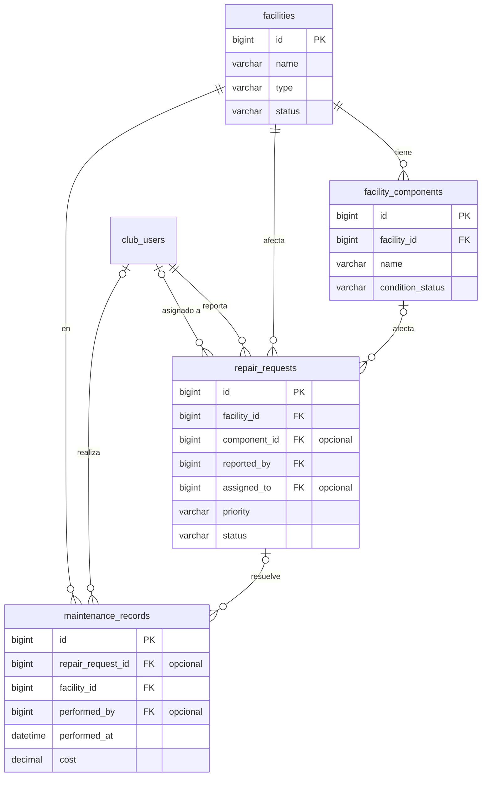

# 7. Instalaciones y mantenimiento

[← Índice](README.md)

Instalaciones del club (canchas, gimnasio, vestuarios), sus componentes, los pedidos de reparación y los trabajos realizados.

## `facilities`

| Columna | Tipo | Null | Restricciones | Descripción |
|---|---|---|---|---|
| `id` | BIGINT UNSIGNED | no | PK | |
| `name` | VARCHAR(120) | no | | Cancha, gimnasio, vestuario |
| `type` | VARCHAR(50) | no | | `court` / `gym` / `locker_room` / `other` |
| `location` | VARCHAR(200) | sí | | Ubicación física |
| `status` | VARCHAR(20) | no | | `active` / `out_of_service` |
| `notes` | TEXT | sí | | |
| `created_at`, `updated_at` | TIMESTAMP | sí | | |
| `deleted_at` | TIMESTAMP | sí | | *(convención ABM)* |

## `facility_components`

| Columna | Tipo | Null | Restricciones | Descripción |
|---|---|---|---|---|
| `id` | BIGINT UNSIGNED | no | PK | |
| `facility_id` | BIGINT UNSIGNED | no | FK → `facilities.id` | |
| `name` | VARCHAR(100) | no | | Aro, tablero, piso, iluminación, reloj |
| `condition_status` | VARCHAR(30) | no | | `good` / `fair` / `poor` / `broken`. El borrador la llama `condition` ([diferencia 6](README.md#diferencias-con-el-borrador-y-con-el-repo)) |
| `last_inspected_at` | DATETIME | sí | | |
| `notes` | TEXT | sí | | |
| `created_at`, `updated_at` | TIMESTAMP | sí | | |

## `repair_requests`

| Columna | Tipo | Null | Restricciones | Descripción |
|---|---|---|---|---|
| `id` | BIGINT UNSIGNED | no | PK | |
| `facility_id` | BIGINT UNSIGNED | no | FK → `facilities.id` | |
| `component_id` | BIGINT UNSIGNED | sí | FK → `facility_components.id` | |
| `reported_by` | BIGINT UNSIGNED | no | FK → `club_users.id` | |
| `assigned_to` | BIGINT UNSIGNED | sí | FK → `club_users.id` | Responsable |
| `title` | VARCHAR(150) | no | | |
| `description` | TEXT | no | | |
| `priority` | VARCHAR(20) | no | default `normal` | `low` / `normal` / `high` / `urgent` |
| `status` | VARCHAR(30) | no | | `open` / `assigned` / `in_progress` / `resolved` / `cancelled` |
| `reported_at` | DATETIME | no | | |
| `resolved_at` | DATETIME | sí | | |
| `created_at`, `updated_at` | TIMESTAMP | sí | | |
| `deleted_at` | TIMESTAMP | sí | | *(convención ABM)* |

- Índice: `(status, priority)` para la bandeja de mantenimiento.
- Si hay `component_id`, el componente tiene que ser de la misma `facility_id`. Una FK simple no lo garantiza: se valida en la aplicación.

## `maintenance_records`

| Columna | Tipo | Null | Restricciones | Descripción |
|---|---|---|---|---|
| `id` | BIGINT UNSIGNED | no | PK | |
| `repair_request_id` | BIGINT UNSIGNED | sí | FK → `repair_requests.id` | `NULL` para mantenimiento preventivo |
| `facility_id` | BIGINT UNSIGNED | no | FK → `facilities.id` | |
| `performed_by` | BIGINT UNSIGNED | sí | FK → `club_users.id` | `NULL` si lo hizo alguien externo |
| `performed_at` | DATETIME | no | | |
| `description` | TEXT | no | | Trabajo realizado |
| `cost` | DECIMAL(12,2) | sí | | Opcional; no implica un módulo financiero |
| `created_at`, `updated_at` | TIMESTAMP | sí | | |
