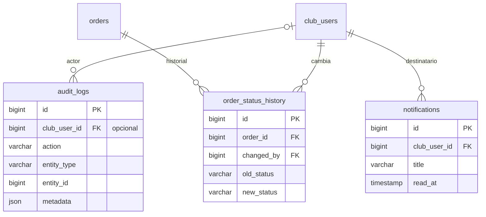

# 8. Auditoría, historial y notificaciones

[← Índice](README.md)

Tablas transversales. Son de solo inserción (salvo `notifications.read_at`) y no tienen `deleted_at`.

## `audit_logs`

| Columna | Tipo | Null | Restricciones | Descripción |
|---|---|---|---|---|
| `id` | BIGINT UNSIGNED | no | PK | |
| `club_user_id` | BIGINT UNSIGNED | sí | FK → `club_users.id` | Actor; `NULL` para acciones del sistema (jobs) |
| `action` | VARCHAR(100) | no | | `player.updated`, `evaluation.viewed`… |
| `entity_type` | VARCHAR(100) | no | | `player`, `order`… |
| `entity_id` | BIGINT UNSIGNED | sí | | |
| `metadata` | JSON | sí | | Datos adicionales **filtrados**: nunca contraseñas, tokens ni datos de salud completos |
| `ip_address` | VARCHAR(45) | sí | | IPv4 o IPv6 (dato personal) |
| `created_at` | TIMESTAMP | no | | |

- Índices: `(entity_type, entity_id)` y `(club_user_id, created_at)`.
- `entity_type` + `entity_id` es una referencia polimórfica, sin FK. Usar alias cortos (con `Relation::enforceMorphMap`) en vez del nombre de la clase PHP, para que un refactor no rompa el historial.
- Falta definir cuánto tiempo se conservan los registros.

## `order_status_history`

| Columna | Tipo | Null | Restricciones | Descripción |
|---|---|---|---|---|
| `id` | BIGINT UNSIGNED | no | PK | |
| `order_id` | BIGINT UNSIGNED | no | FK → `orders.id` | |
| `changed_by` | BIGINT UNSIGNED | no | FK → `club_users.id` | |
| `old_status` | VARCHAR(30) | sí | | `NULL` en la creación |
| `new_status` | VARCHAR(30) | no | | |
| `comment` | VARCHAR(255) | sí | | Motivo, por ejemplo del rechazo |
| `created_at` | TIMESTAMP | no | | |

- Índice: `(order_id, created_at)`.
- Se inserta en la misma transacción que el cambio de `orders.status`.

## `notifications`

| Columna | Tipo | Null | Restricciones | Descripción |
|---|---|---|---|---|
| `id` | BIGINT UNSIGNED | no | PK | |
| `club_user_id` | BIGINT UNSIGNED | no | FK → `club_users.id` | Destinatario |
| `title` | VARCHAR(150) | no | | |
| `body` | TEXT | no | | |
| `read_at` | TIMESTAMP | sí | | |
| `created_at` | TIMESTAMP | no | | |

- Índice: `(club_user_id, read_at)` para contar las no leídas.
- Es una tabla propia, no la tabla `notifications` del sistema de notificaciones de Laravel (que usa UUID y `notifiable` polimórfico). Si se quiere usar el canal `database` de Laravel, hay que adaptar el esquema en el change del módulo.
- Las notificaciones que se generan en un job reciben el `tenantId` y el `club_user_id`, no modelos (ver [guía de jobs](../guia-jobs.md)).
