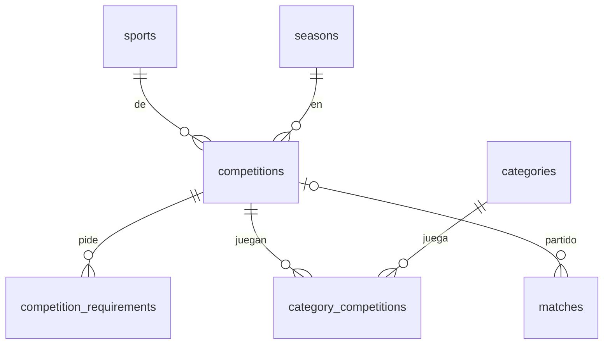

# 9. Competencias y habilitación

[← Índice](README.md)

Ligas y torneos del club, qué categorías los juegan y qué papeles pide cada uno para habilitar a un jugador (TIZ-31). Los requisitos cambian según el deporte y la liga, así que no están fijos en el sistema: los configura cada club. El estado de cada requisito por jugador llega con TIZ-32.

## `competitions`

| Columna | Tipo | Null | Restricciones | Descripción |
|---|---|---|---|---|
| `id` | BIGINT UNSIGNED | no | PK | |
| `sport_id` | BIGINT UNSIGNED | no | FK → `sports.id` | |
| `season_id` | BIGINT UNSIGNED | no | FK → `seasons.id` | |
| `name` | VARCHAR(150) | no | | "Liga Metropolitana de Básquet" |
| `organizer` | VARCHAR(150) | sí | | Liga o federación |
| `registration_deadline` | DATE | sí | | Cierre de inscripción |
| `created_at`, `updated_at` | TIMESTAMP | sí | | |
| `deleted_at` | TIMESTAMP | sí | | *(convención ABM)* |

- Índice: `(season_id, sport_id)`.
- Para la temporada siguiente se copia la competencia (`POST /competitions/{id}/copy`): trae los requisitos, no las categorías.

## `category_competitions`

| Columna | Tipo | Null | Restricciones | Descripción |
|---|---|---|---|---|
| `id` | BIGINT UNSIGNED | no | PK | |
| `category_id` | BIGINT UNSIGNED | no | FK → `categories.id` | |
| `competition_id` | BIGINT UNSIGNED | no | FK → `competitions.id`, `ON DELETE CASCADE` | |

- `UNIQUE (category_id, competition_id)`. Una categoría puede jugar varias competencias; se le piden los requisitos de todas.
- Las categorías tienen que ser del deporte de la competencia (se valida en la aplicación).

## `competition_requirements`

| Columna | Tipo | Null | Restricciones | Descripción |
|---|---|---|---|---|
| `id` | BIGINT UNSIGNED | no | PK | |
| `competition_id` | BIGINT UNSIGNED | no | FK → `competitions.id`, `ON DELETE CASCADE` | |
| `name` | VARCHAR(120) | no | | Ficha federativa, apto médico, DNI... |
| `validity_months` | SMALLINT UNSIGNED | sí | | Meses de validez; `NULL` = no vence |
| `requires_file` | BOOLEAN | no | default `false` | Pide un archivo (TIZ-29) |
| `minors_only` | BOOLEAN | no | default `false` | Solo a menores de 18, según `players.birth_date` |
| `is_required` | BOOLEAN | no | default `true` | Obligatorio para quedar habilitado |
| `sort` | SMALLINT UNSIGNED | no | default `0` | Orden en la grilla |
| `created_at`, `updated_at` | TIMESTAMP | sí | | |

- La API recibe la lista completa: con `id` edita, sin `id` crea y los que no vienen se borran.

## Cambio en `matches`

`competition_id` (nullable, FK → `competitions.id`, `ON DELETE SET NULL`): la competencia del partido.

## `player_requirements`

Estado de cada requisito por jugador (TIZ-32). Sin fila, el requisito está **pendiente**.

| Columna | Tipo | Null | Restricciones | Descripción |
|---|---|---|---|---|
| `id` | BIGINT UNSIGNED | no | PK | |
| `player_id` | BIGINT UNSIGNED | no | FK → `players.id`, `ON DELETE CASCADE` | |
| `competition_requirement_id` | BIGINT UNSIGNED | no | FK → `competition_requirements.id`, `ON DELETE CASCADE` | |
| `status` | VARCHAR(20) | no | | `pending` / `submitted` / `approved` / `rejected` / `expired` |
| `document_id` | BIGINT UNSIGNED | sí | FK → `documents.id`, `ON DELETE SET NULL` | El papel presentado (obligatorio si el requisito `requires_file`) |
| `submitted_at` | TIMESTAMP | sí | | |
| `expires_at` | DATE | sí | | Al aprobar: hoy + `validity_months`, o la fecha que se mande |
| `reviewed_by` | BIGINT UNSIGNED | sí | FK → `club_users.id` | Quién aprobó o rechazó |
| `reviewed_at` | TIMESTAMP | sí | | |
| `rejection_reason` | VARCHAR(255) | sí | | |
| `created_at`, `updated_at` | TIMESTAMP | sí | | |

- `UNIQUE (player_id, competition_requirement_id)`; índice `(status, expires_at)` para el vencimiento.

### Quién está habilitado

- A un jugador le aplican los requisitos de las competencias de **sus categorías activas**. Los `minors_only` no aplican si ya cumplió 18.
- Está **habilitado** si tiene aprobados y vigentes todos los obligatorios que le aplican.
- Un aprobado con `expires_at` pasado cuenta como vencido al momento. Además, `club:expire-requirements` corre todos los días a las 03:00 y deja el estado guardado en `expired`.
- Endpoints: `GET /api/eligibility` (resumen por categoría), `GET /api/categories/{id}/eligibility` (grilla), `GET /api/players/{id}/eligibility` y `POST /api/players/{player}/requirements/{requirement}/submit | approve | reject`.
