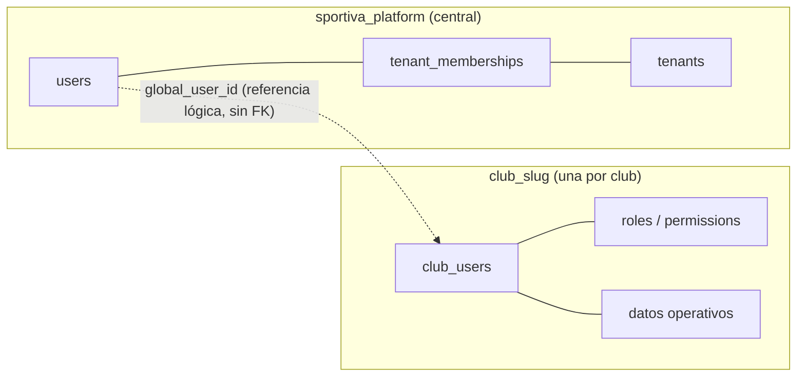

# Modelo de datos de la base de cada club

> **Estado: esquema migrado, ABM en curso.** Las 39 tablas existen como migraciones en `database/migrations/tenant/` y se aplican a **cada** base `club_<slug>`. Los modelos, endpoints y permisos de cada módulo siguen pasando por su change de OpenSpec (`/opsx:propose`). Si un change necesita cambiar una tabla, lo hace con una migración nueva (nunca editando una mergeada) y actualiza el documento del módulo.

Fuente: el borrador técnico *OLIM · Modelo relacional de bases de datos y autenticación multi-tenant* (PDF del equipo), adaptado a las convenciones de este repo. Las diferencias con el borrador están en [Diferencias con el borrador](#diferencias-con-el-borrador-y-con-el-repo).

Contexto general: [arquitectura multi-tenant](../arquitectura-multi-tenant.md) y [guía de bases de datos](../guia-bases-de-datos.md).

> **¿Vas a implementar ABM del club?** Empezá por el [plan de implementación](plan-implementacion.md): quién hace qué, qué tiene que existir antes, el orden por olas y el paso a paso.

## Índice de módulos

| # | Módulo | Tablas |
|---|---|---|
| 1 | [Identidad local y autorización](01-identidad-y-autorizacion.md) | `club_users`, `roles`, `permissions`, `club_user_roles`, `role_permissions` |
| 2 | [Deportes, temporadas y planteles](02-deportes-y-planteles.md) | `sports`, `seasons`, `categories`, `players`, `player_category_memberships`, `coaches`, `category_coaches` |
| 3 | [Pedidos e indumentaria](03-pedidos-e-indumentaria.md) | `orders`, `apparel_items`, `apparel_order_items`, `materials`, `material_order_items` |
| 4 | [Depósitos e inventario](04-inventario.md) | `storage_locations`, `inventory_balances`, `inventory_movements` |
| 5 | [Partidos, entrenamientos y asistencia](05-calendario-y-asistencia.md) | `matches`, `trainings`, `player_attendance`, `match_callups` |
| 6 | [Evaluaciones físicas](06-evaluaciones-fisicas.md) | `physical_evaluations`, `physical_measurements` |
| 7 | [Instalaciones y mantenimiento](07-instalaciones-y-mantenimiento.md) | `facilities`, `facility_components`, `repair_requests`, `maintenance_records` |
| 8 | [Auditoría, historial y notificaciones](08-auditoria-y-notificaciones.md) | `audit_logs`, `order_status_history`, `notifications` |
| 9 | [Competencias y habilitación](09-competencias-y-habilitacion.md) | `competitions`, `category_competitions`, `competition_requirements`, `player_requirements` |
| 10 | [Documentos](10-documentos.md) | `documents` |

En total son 39 tablas, todas en la misma base del club: las 32 del borrador más `player_contacts` (TIZ-15), las 3 de competencias (TIZ-31), `documents` (TIZ-29), `player_requirements` (TIZ-32) y `match_callups` (TIZ-33).

## Decisiones de modelado

| Tema | Decisión |
|---|---|
| Una base por club | Todas las bases `club_<slug>` tienen el **mismo esquema** y la misma versión de migraciones (las aplica `tenants:migrate`). |
| Sin `tenant_id` ni `club_id` | Las tablas del club no llevan columna de club: el aislamiento lo da la base. Agregar una sería redundante y alguien podría usarla como fuente de autorización. |
| Categoría = plantel | `categories` es el equipo que compite, por deporte y temporada (U21, Primera, Pre-mini). No hay tabla `teams`. Partidos y entrenamientos referencian `category_id`. |
| Historial de planteles | `player_category_memberships` guarda en qué categoría estuvo cada jugador, y desde y hasta cuándo. |
| Evaluación física flexible | Una evaluación (evento) tiene N mediciones (`metric_key` + valor). Una prueba nueva no necesita una columna nueva. |
| Inventario con libro de movimientos | `inventory_movements` es inmutable; `inventory_balances` es el saldo, que se actualiza en la misma transacción. |
| Fuera del alcance inicial | Objetivos de jugador, progreso de objetivos, estadísticas individuales (minutos, goles, puntos), módulo financiero (compras, contabilidad, cuotas) y una tabla `teams`. |

## Relación con la base central

- `club_users.global_user_id` apunta a `sportiva_platform.users.id`, pero **no es una FK**: MySQL no tiene FK entre bases, y el club no tiene que depender de la base central para mantener su integridad.
- Quién puede entrar a un club lo decide `tenant_memberships` (central). Qué puede hacer adentro lo deciden los roles y permisos del club (módulo 1).
- Todas las demás FK apuntan a tablas de la misma base del club.

## ER general (relaciones entre módulos)

Muestra solo las tablas y sus relaciones. Los campos están en el documento de cada módulo.

```mermaid
erDiagram
    club_users ||--o{ club_user_roles : tiene
    roles ||--o{ club_user_roles : asigna
    roles ||--o{ role_permissions : incluye
    permissions ||--o{ role_permissions : otorga

    sports ||--o{ categories : agrupa
    seasons ||--o{ categories : agrupa
    players ||--o{ player_category_memberships : integra
    categories ||--o{ player_category_memberships : contiene
    club_users |o--o| coaches : "cuenta de"
    categories ||--o{ category_coaches : dirige
    coaches ||--o{ category_coaches : asignado

    club_users ||--o{ orders : solicita
    categories |o--o{ orders : "para"
    orders ||--o{ apparel_order_items : contiene
    apparel_items ||--o{ apparel_order_items : prenda
    players ||--o{ apparel_order_items : destinatario
    orders ||--o{ material_order_items : contiene
    materials ||--o{ material_order_items : material

    materials ||--o{ inventory_balances : saldo
    storage_locations ||--o{ inventory_balances : saldo
    materials ||--o{ inventory_movements : mueve
    storage_locations ||--o{ inventory_movements : en
    orders |o--o{ inventory_movements : origina
    club_users ||--o{ inventory_movements : registra

    categories ||--o{ matches : juega
    categories ||--o{ trainings : entrena
    coaches |o--o{ trainings : responsable
    players ||--o{ player_attendance : asiste
    trainings |o--o{ player_attendance : evento
    matches |o--o{ player_attendance : evento

    players ||--o{ physical_evaluations : evaluado
    coaches ||--o{ physical_evaluations : evalua
    physical_evaluations ||--o{ physical_measurements : mide

    facilities ||--o{ facility_components : tiene
    facilities ||--o{ repair_requests : afecta
    facility_components |o--o{ repair_requests : afecta
    repair_requests |o--o{ maintenance_records : resuelve
    facilities ||--o{ maintenance_records : en

    club_users |o--o{ audit_logs : actor
    orders ||--o{ order_status_history : historial
    club_users ||--o{ notifications : destinatario
```

## Convenciones de este documento

- **PK** clave primaria, **FK** clave foránea, **UK** `UNIQUE`. "Null" = sí indica que la columna es opcional.
- Los tipos son la propuesta para MySQL 8.4. En la migración se escriben con el *schema builder* de Laravel: `id()` es `BIGINT UNSIGNED` autoincremental, `foreignId()` es `BIGINT UNSIGNED`, `timestamps()` agrega `created_at` y `updated_at`, y `softDeletes()` agrega `deleted_at`.
- Los estados (`status`, `type`, `priority`) son `VARCHAR` con valores en inglés y se validan en la aplicación (un `enum` de PHP más una regla `in:` en el Form Request). No se usa `ENUM` de MySQL, porque agregar un valor obligaría a alterar la tabla en todas las bases de club.
- Los `DATETIME` y `TIMESTAMP` se guardan en **UTC**, y la API los devuelve en ISO 8601 con zona horaria.
- `deleted_at` marcado como *(convención ABM)* no figura en el borrador: lo exige [guia-abm.md §10](../guia-abm.md#10-bajas-soft-delete-o-borrado-real) para las entidades de negocio con historia.
- Las FK son reales (InnoDB). La regla por defecto es `ON DELETE RESTRICT`: no hay borrados en cascada de evaluaciones, pedidos, movimientos ni auditoría. Las excepciones se indican en cada tabla.

## Diferencias con el borrador y con el repo

Son puntos donde el PDF y el repo no coinciden, o donde el PDF tiene un problema técnico. Hay que resolverlos en revisión; este documento ya aplica la opción indicada como "en este doc".

| # | Tema | Borrador (PDF) | Repo / problema | En este doc |
|---|---|---|---|---|
| 1 | Nombres de las bases | `olim_platform`, `olim_club_001` | El código y la documentación usan `sportiva_platform` y `club_<slug>` (`club_<id>` sigue abierto, ver [arquitectura](../arquitectura-multi-tenant.md#decisiones-que-necesitan-aprobación-antes-de-implementar)) | Nombres del repo |
| 2 | Soft delete | Sin `deleted_at` | `guia-abm.md` lo exige para entidades de negocio | `deleted_at` agregado y marcado *(convención ABM)* |
| 3 | Credenciales por club en `tenants` | `database_host`, `database_port`, `database_secret_ref` | La arquitectura dice que `tenants` guarda solo el nombre de la base y que las credenciales propias por club necesitan su propio ADR | Fuera del alcance (es la base central) |
| 4 | Dónde vive el rol | Roles en la base del club (`club_user_roles`) | [guia-bases-de-datos.md §2](../guia-bases-de-datos.md#2-qué-vive-en-cada-base-y-por-qué) dice que la membresía central indica "con qué rol" | **Resuelto (TIZ-10):** roles solo en el club; `tenant_memberships.role` se elimina ([roles-y-permisos §8](../roles-y-permisos.md#8-cambios-de-esquema)) |
| 5 | `permissions.key` | Columna `key` | `KEY` es palabra reservada de MySQL: Eloquent la escapa, pero rompe SQL escrito a mano y algunas herramientas | Se propone `permissions.name` |
| 6 | `facility_components.condition` | Columna `condition` | `CONDITION` también es palabra reservada | Se propone `condition_status` |
| 7 | Unicidad de asistencia | "Unicidad por evento y jugador" | Un `UNIQUE(player_id, training_id, match_id)` no sirve: MySQL no compara `NULL` en índices únicos, así que permitiría duplicados | Dos índices: `UNIQUE(player_id, training_id)` y `UNIQUE(player_id, match_id)` |
| 8 | `category_coaches` con PK compuesta | PK `(category_id, coach_id)` con fechas de inicio y fin | Con esa PK un entrenador no puede tener dos asignaciones en la misma categoría (otro rol, o volver después de irse), así que las fechas no sirven como historial | Se propone `id` propio + índice en `(category_id, coach_id, assignment_type)` |
| 9 | Seeder de roles | Lista de roles en `roles.name` | Los roles y permisos iniciales los carga el alta del club (job `ProvisionTenant`) | **Resuelto (TIZ-10):** `config/club-permissions.php` + `club:sync-permissions` ([roles-y-permisos §9](../roles-y-permisos.md#9-sincronización-del-catálogo)) |

## Pendientes antes de migrar

- Resolver la tabla anterior en revisión.
- Datos personales (jugadores menores, documento, evaluaciones físicas, IP en auditoría): definir quién los ve, cuánto tiempo se guardan y si `document_number` hace falta. Cada módulo lo vuelve a plantear donde aplica.
- Orden de implementación sugerido (cada uno, un change de OpenSpec): conexión `tenant` + alta de clubes → módulo 1 → módulo 2 → los demás según la prioridad del producto.
